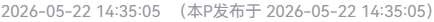

# B站分P发布时间显示

多分 P 视频只显示第 1 P 的发布时间，这个脚本把「当前这一 P」的发布时间补在后面。

写它是因为考古老合集（教程系列、搬运合集）时想知道每一 P 分别是什么时候传的。B 站的接口其实返回了每一 P 的时间，页面上就是没显示出来。

## 效果

打开任意多分 P 视频，标题下方发布日期后面会多出一截：

```
2023-05-12 18:03:41（本P发布于 2023-05-19 20:15:07）
```

切 P 自动跟着变。单 P 视频不显示（没必要）。



## 安装

先装脚本管理器：[Tampermonkey](https://www.tampermonkey.net/) 或 [ScriptCat](https://scriptcat.org/) 都行。

然后二选一：

- **GitHub 源**：[点这里安装](https://github.com/wkkwky/bilibili-part-pubdate/raw/main/bilibili-part-pubdate.user.js)
- **Greasyfork**：[点这里安装](https://greasyfork.org/zh-CN/scripts/602160)

管理器不认就手动装：面板 → 添加新脚本 → 清空编辑器 → 粘贴脚本全文 → 保存。

## 原理

一句话：调 `api.bilibili.com/x/web-interface/view?bvid=xxx`，返回的 `pages` 数组里每一 P 都带 `ctime`，找到当前 `?p=` 对应的那一 P，把时间插到发布日期那个 span 里。

两个实现细节：

- B 站切 P 是 SPA 无刷新跳转，没有可靠的导航事件，所以用 1 秒轮询兜底。每秒一次选择器查询，开销可以忽略。
- 同一稿件只请求一次接口，结果缓存在内存里，切 P 不重复请求。

另外，页面上 `.pubdate-ip-text` 往往不止一个：一个在标题下方的信息行，其余藏在 `.overflow-panel` 里（标题太长时站点会多渲染一份用于折叠/展开的副本）。脚本对所有副本都写入，两处都能看到。

## 常见问题

**没显示？**

先确认是多 P 视频，单 P 本来就不显示。如果确认多 P 还是没有，八成是 B 站改版把发布日期那块的 class 名改了，欢迎提 Issue。

**时间不对？**

按浏览器本地时区显示的。

## 隐私

只请求 `api.bilibili.com/x/web-interface/view` 这一个接口，不收集任何数据。

## 已知限制

- 只在 `www.bilibili.com/video/` 页面生效
- 依赖页面现有结构，B 站改版可能失效

## 更新日志

- **1.0.2**（2026-10-31）修复部分视频的文字被追加到隐藏标题、页面上看不到的问题
- **1.0.1**（2026-10-26）补发布用的元信息，接口请求失败时不再往控制台抛错
- **1.0** 初版

## 反馈

有问题去 [Issues](https://github.com/wkkwky/bilibili-part-pubdate/issues) 提，或者在 [Greasyfork 反馈区](https://greasyfork.org/zh-CN/scripts/602160/feedback)留言。

## License

[MIT](LICENSE)
